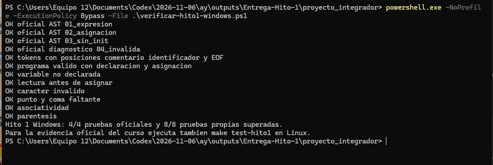
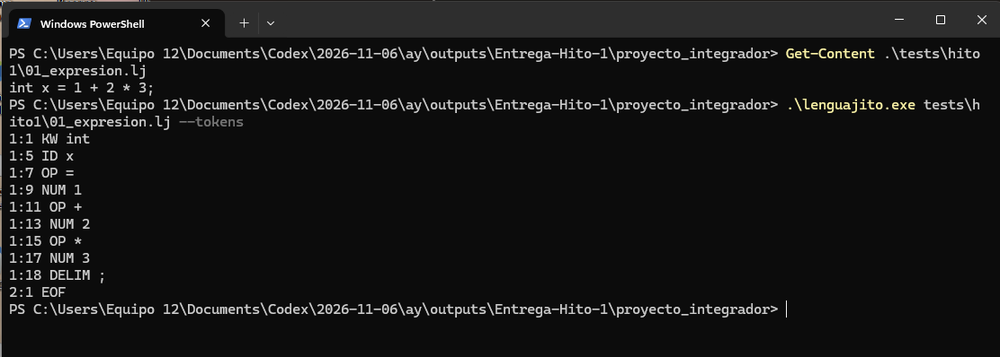
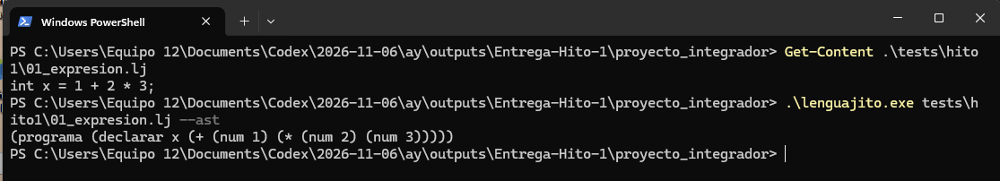
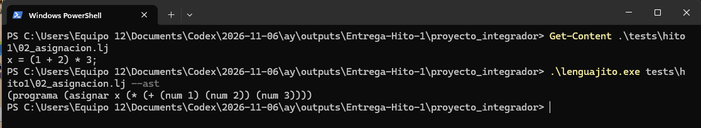
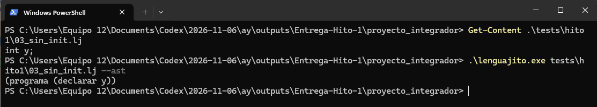
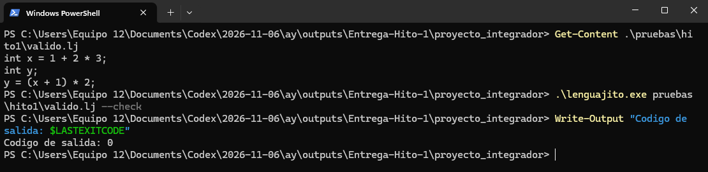
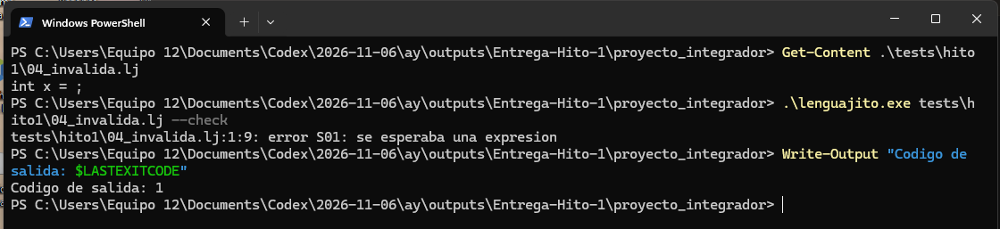
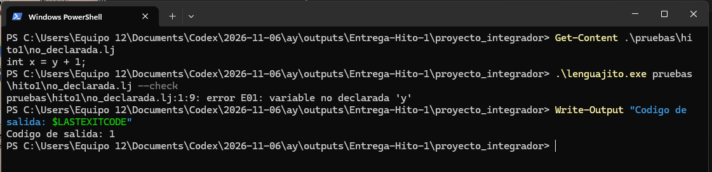
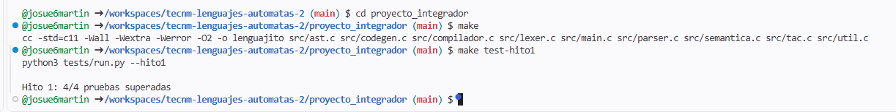

# Reporte del Hito 1 de Lenguajito

## Análisis léxico sintáctico y árbol de sintaxis abstracta

TecNM Cancún

Lenguajes y Autómatas II SCD-1016

**Equipo**

Ingrid Paola Dzul Segovia

Jonathan Uriel Che Castillo

Josue Efrain Martin Pool

6 de noviembre de 2026

## Resumen

Este reporte describe la preparación de la primera entrega del compilador Lenguajito. El alcance comprende lectura de archivos, reconocimiento de tokens, análisis sintáctico descendente recursivo, construcción e impresión del AST y comprobaciones básicas mediante S01 y E01. El código está escrito en C11 y conserva la organización modular del proyecto.

La ejecución específica del Hito 1 en PowerShell superó cuatro pruebas oficiales y ocho propias. Ocho capturas reales documentan la verificación, los tokens, los tres AST, la aceptación de un programa válido y los errores S01/E01. Los casos inválidos finalizaron con código 1 y el programa válido con código 0, tal como establece el contrato. La prueba oficial `make test-hito1` también superó sus cuatro casos en Linux mediante GitHub Codespaces. La figura 9 conserva esa evidencia. El tag `v0.1-hito1` ya está publicado sobre `3e09970377805c528cccd4936de765530bf96d00` y se conserva. La revisión personal del equipo y la demo quedan pendientes de documentar.

## Objetivo

Demostrar que un archivo Lenguajito puede transformarse en tokens y en un AST que respeta la gramática, la precedencia y la asociatividad, y que los programas inválidos reciben diagnósticos con archivo, línea, columna y código.

La entrega sigue la definición de terminado de `PROYECTO.md`, sección 4. No exige demostrar TAC, optimización, ensamblador ni un binario ELF. Los módulos existentes de esas etapas se conservan por compatibilidad con la integración, sin acreditarlos dentro de esta presentación.

<!-- PAGEBREAK -->

## Diseño del compilador

El procesamiento comienza en `main.c`, que valida el archivo y el modo solicitado. `compilador.c` lee la fuente y coordina las etapas. El lexer transforma caracteres en tokens; el parser consume esos tokens y construye nodos; el módulo AST imprime la estructura. El modo `--check` añade comprobaciones semánticas básicas.

```text
Archivo .lj
    |
    v
Lexer con posiciones
    |
    +---- --tokens ----> Lista de tokens
    v
Parser descendente y AST
    |
    +---- --ast -------> Arbol en parentesis
    v
Comprobacion de nombres e inicializacion
    |
    +---- --check -----> Aceptacion o diagnosticos
```

## Análisis léxico

`lexer.c` recorre la entrada y mantiene línea y columna desde 1. Reconoce palabras reservadas completas, identificadores, números, operadores y delimitadores. Omite espacios y comentarios `//`. Ante un carácter fuera del contrato emite S01 y agrega un único EOF al final de la secuencia.

| Categoría | Elementos representativos |
| :--- | :--- |
| KW | int, if, else, while, print |
| ID | x, suma, _x2 |
| NUM | 0, 10, 42 |
| OP | +, -, *, /, =, <=, ==, != |
| DELIM | (, ), {, }, ; |
| EOF | Fin de archivo |

Para `int x = 1;`, cada token se presenta como `LINEA:COLUMNA TIPO lexema`. Por ejemplo, `1:1 KW int` identifica el inicio de la declaración y `1:5 ID x` identifica su nombre. El signo negativo es un operador, no parte del token numérico. Los operadores de dos caracteres se reconocen antes de finalizar el token correspondiente.

El lexer reconoce unidades léxicas; no decide si la combinación forma una sentencia válida ni calcula resultados.

<!-- PAGEBREAK -->

## Parser y construcción del AST

El parser está escrito a mano en `parser.c`, sin generadores. Sus funciones siguen los niveles de la gramática: expresión, aditiva, multiplicativa, unaria y primaria. Una aditiva consume multiplicativas completas; por eso `*` y `/` tienen prioridad sobre `+` y `-`. Los ciclos que acumulan operadores binarios conservan la asociatividad a la izquierda.

`ast.c` construye e imprime nodos para programa, declaración, asignación, números, variables y operaciones. El AST elimina detalles de puntuación que no aportan estructura y conserva las relaciones necesarias para interpretar la expresión.

### Primer programa con precedencia

Prueba oficial `tests/hito1/01_expresion.lj`:

```text
int x = 1 + 2 * 3;
```

Salida esperada, en una sola línea:

```text
(programa (declarar x (+ (num 1) (* (num 2) (num 3)))))
```

La suma contiene la multiplicación en su hijo derecho. El AST representa la estructura y no reemplaza la expresión por el valor 7.

### Segundo programa con paréntesis y asignación

Prueba oficial `tests/hito1/02_asignacion.lj`:

```text
x = (1 + 2) * 3;
(programa (asignar x (* (+ (num 1) (num 2)) (num 3))))
```

Los paréntesis colocan la suma dentro de la multiplicación. `--ast` acepta esta estructura sintáctica aunque no haya una declaración de `x`; `--check` sí debe detectar ese uso sin declarar.

### Tercer programa con declaración sin inicializador

Prueba oficial `tests/hito1/03_sin_init.lj`:

```text
int y;
(programa (declarar y))
```

La declaración es válida. Leer `y` antes de asignarle un valor debe producir E01 en la comprobación semántica. Una prueba propia adicional comprueba que `10 - 3 - 2` se agrupa como `(10 - 3) - 2`.

<!-- PAGEBREAK -->

## Comprobación y diagnósticos

El modo `--check` ejecuta lectura, lexer, parser y análisis semántico. Un programa correcto termina con código 0. Un error de compilación termina con 1; una invocación incorrecta de la interfaz termina con 2. El diagnóstico sigue el formato del contrato:

```text
archivo:linea:columna: error CODIGO: mensaje
```

S01 identifica caracteres inválidos o estructuras sintácticas incompletas. E01 identifica variables sin declarar o lecturas antes de asignación. En esta entrega se incluyen ejemplos separados para distinguir las dos etapas y evitar interpretar un rechazo esperado como una falla del verificador.

```text
int x = ;       // S01, falta una expresion
int x = y + 1;  // E01, y no se ha declarado
```

## Plan de pruebas

Las pruebas doradas originales permanecen sin cambios en `tests/`. Los casos propios se guardan en `pruebas/hito1/`. Se compara la salida completa de AST y tokens; los casos inválidos comprueban código de salida, código de diagnóstico y posición.

| Origen | Caso | Resultado esperado |
| :--- | :--- | :--- |
| Oficial | Expresión 1 + 2 * 3 | AST con precedencia |
| Oficial | Asignación con paréntesis | AST de asignación |
| Oficial | int y; | AST sin inicializador |
| Oficial | int x = ; | S01 en línea 1 |
| Propia | Comentario e identificador _x2 | Tokens y posiciones exactos |
| Propia | Declaraciones y asignación válidas | Código 0 sin diagnósticos |
| Propia | Variable y no declarada | E01 en 1:9 |
| Propia | Lectura de x sin valor | E01 en 2:9 |
| Propia | Carácter @ | S01 en 1:9 |
| Propia | Falta de punto y coma | S01 en 2:1 |
| Propia | 10 - 3 - 2 | AST asociado a la izquierda |
| Propia | (1 + 2) * 3 | AST con paréntesis prioritarios |

Los doce casos del verificador específico pasaron en Windows, según la captura de la figura 1. Los ocho casos propios complementan la cobertura oficial; la aprobación no significa que se hayan probado todas las entradas posibles del lenguaje. En Linux, `make test-hito1` superó sus cuatro casos oficiales, como muestra la figura 9. Los ocho casos propios están acreditados por la ejecución de Windows y por GitHub Actions en Linux, como se documenta en la sección de resultados.

<!-- PAGEBREAK -->

## Evidencias reales de ejecución en Windows

Las figuras 1 a 8 muestran la ejecución real en PowerShell. Se conservan completas, con comandos y resultados, para distinguir las salidas correctas de los rechazos esperados.

### Verificación del Hito 1

```powershell
powershell.exe -NoProfile -ExecutionPolicy Bypass -File .\verificar-hito1-windows.ps1
```



El script compila con C11 y `-Wall -Wextra -Werror -O2`. La captura muestra doce casos OK y el resumen 4/4 oficiales y 8/8 propias. El mensaje sobre Linux recuerda la evidencia oficial pendiente.

### Análisis léxico del programa de expresión



Para `int x = 1 + 2 * 3;`, el lexer identifica KW, ID, NUM, OP y DELIM. `1:5 ID x` ubica el identificador en la línea 1, columna 5. `2:1 EOF` indica el final del archivo después del salto de línea. La salida corresponde al modo `--tokens`.

<!-- PAGEBREAK -->

## Evidencias de precedencia y paréntesis

### Primer AST con precedencia de multiplicación

```powershell
.\lenguajito.exe tests\hito1\01_expresion.lj --ast
```



El programa es `int x = 1 + 2 * 3;`. En la salida, el nodo `+` tiene como hijo izquierdo `(num 1)` y como hijo derecho `(* (num 2) (num 3))`. Esto comprueba la estructura que exige la precedencia. Se imprime un árbol, no el valor numérico de la expresión.

### Segundo AST con paréntesis y asignación

```powershell
.\lenguajito.exe tests\hito1\02_asignacion.lj --ast
```



Para `x = (1 + 2) * 3;`, el nodo de multiplicación recibe la suma como hijo izquierdo. El nodo `asignar x` distingue la asignación de una declaración. Este archivo sirve para probar sintaxis: que `--ast` lo acepte no demuestra que `x` esté declarada. Esa condición corresponde a `--check`.

<!-- PAGEBREAK -->

## Evidencias de declaración y aceptación

### Tercer AST con declaración sin inicializador

```powershell
.\lenguajito.exe tests\hito1\03_sin_init.lj --ast
```



El archivo contiene `int y;` y produce `(programa (declarar y))`. El nodo conserva el nombre de la variable y no contiene una expresión de inicialización. Esta captura completa los tres programas de AST exigidos en el Hito 1.

### Aceptación de un programa válido

```powershell
.\lenguajito.exe pruebas\hito1\valido.lj --check
Write-Output "Codigo de salida: $LASTEXITCODE"
```



El programa declara `x` con un valor, declara `y` y le asigna una expresión que usa `x`. El modo `--check` no emite diagnósticos y termina con código 0. La ausencia de mensajes en este modo es el comportamiento correcto cuando no se detectan errores.

<!-- PAGEBREAK -->

## Evidencias de detección de errores

### Error sintáctico S01

```powershell
.\lenguajito.exe tests\hito1\04_invalida.lj --check
Write-Output "Codigo de salida: $LASTEXITCODE"
```



En `int x = ;` falta una expresión después de `=`. El parser encuentra `;` en la línea 1, columna 9 y emite S01 con el mensaje «se esperaba una expresion». El código de salida 1 confirma el rechazo esperado. La prueba funciona precisamente porque detecta el programa inválido.

### Error semántico básico E01

```powershell
.\lenguajito.exe pruebas\hito1\no_declarada.lj --check
Write-Output "Codigo de salida: $LASTEXITCODE"
```



En `int x = y + 1;` se utiliza `y` sin una declaración previa. El diagnóstico E01 señala la línea 1, columna 9 e identifica la variable. El código de salida 1 coincide con el contrato. La sintaxis de la expresión es válida; el error corresponde a la comprobación del nombre utilizado.

<!-- PAGEBREAK -->

## Resultados y reproducción oficial

En Windows se observó el resultado 4/4 oficial y 8/8 propio. La verificación automática del commit 069a723b7523d2d6ea0be812f22d555e7c5aae42 también terminó con éxito en Linux: 4/4 oficiales del Hito 1, 8/8 propias y 20/20 generales. Los tres AST individuales coinciden con el formato especificado; el análisis léxico muestra posiciones y EOF; el caso válido devuelve 0 y los casos inválidos S01/E01 devuelven 1. Estas conclusiones se apoyan en las capturas anteriores.

Se comprobó además que `src/` y `tests/` se conservaron byte por byte respecto de la copia local revisada y que los scripts nuevos tienen sintaxis válida. Los errores de carga de DLL observados en la sesión automática no impidieron la ejecución posterior en el PowerShell del usuario.

### Prueba oficial en Linux mediante Codespaces

En la terminal Bash del repositorio se ejecutaron los siguientes comandos:

```bash
cd proyecto_integrador
make
make test-hito1
```



La captura muestra el directorio `/workspaces/tecnm-lenguajes-automatas-2/proyecto_integrador` en la rama `main`. `make` ejecuta la compilación con `cc`, C11 y las banderas `-Wall -Wextra -Werror -O2`. Después, `make test-hito1` invoca `python3 tests/run.py --hito1` y finaliza con `Hito 1: 4/4 pruebas superadas`.

Esta salida documenta la prueba oficial del curso en Linux. No se observan errores de compilación ni de pruebas en la captura. Esta figura acredita únicamente los cuatro casos oficiales. Los ocho propios pasaron en Windows y posteriormente en GitHub Actions para Linux. El Hito 1 no exige demostrar un ejecutable ELF.

### Elementos pendientes de cierre

- Usar el commit 069a723b7523d2d6ea0be812f22d555e7c5aae42 como referencia de la integración comprobada; registrar después los commits de las aportaciones humanas.
- Registrar la revisión y las aportaciones reales de los integrantes.
- Ensayar y realizar la demo de tres minutos.
- Revisar el commit de entrega con el equipo. El tag `v0.1-hito1` existente se conserva; este reporte es un complemento documental posterior.

La ejecución oficial de Linux está documentada; las capturas no acreditan por sí solas estos pasos de cierre. Las instrucciones de cierre y el guion están incluidos en la carpeta `docs/`.

<!-- PAGEBREAK -->

## Auditoría de IA y trabajo del equipo

La preparación del material utilizó asistencia de IA. La bitácora completa está en `docs/bitacora-hito1.md`. El registro C-R-E-O de esta solicitud es el siguiente.

**Contexto.** El proyecto ya incluía varias etapas. El usuario recibió la indicación de entregar únicamente el Hito 1 y solicitó reporte, pruebas y sus componentes.

**Rol.** Asistente de programación y documentación encargado de revisar el contrato local, organizar el alcance y preparar material verificable.

**Especificación.** Conservar C11, parser descendente manual, pruebas oficiales intactas, tokens con posiciones, tres AST, errores S01/E01, README y demo de tres minutos.

**Output y auditoría.** Se prepararon este reporte, documentación, ocho pruebas propias y ejecutores para Windows y Linux. Se conservaron las fuentes preexistentes. La revisión humana, la aceptación o corrección de propuestas y los commits individuales deben registrarse después de realizarse.

El reparto propuesto asigna a Ingrid la revisión del lexer; a Jonathan, parser y AST; y a Josue, integración, diagnósticos y pruebas. No representa una atribución de autoría. Todos los integrantes deben comprender las etapas y responder preguntas sobre cualquier parte, conforme a las reglas del curso.

## Conclusiones

La implementación existente permite preparar una entrega modular del Hito 1. Los ejemplos distinguen reconocimiento léxico, estructura sintáctica y comprobaciones básicas de nombres. Las pruebas propias complementan los cuatro casos oficiales con posiciones exactas, comentarios, asociatividad y errores léxicos y semánticos.

Las nueve capturas documentan las pruebas específicas en Windows y la prueba oficial en Linux. La entrega se cierra cuando el equipo revisa el material, documenta sus aportaciones, realiza la demo y vincula la entrega al tag `v0.1-hito1` ya publicado. El tag se conserva sobre el código previo; el reporte y las pruebas nuevas son un complemento posterior. El paquete incluye las instrucciones para completar ese cierre sin alterar las pruebas doradas ni el historial del fork.

## Material de apoyo y referencias

- GitHub Actions del commit de integración: https://github.com/josue6martin/tecnm-lenguajes-automatas-2/actions/runs/42265588230
- `PROYECTO.md`: requisitos, definición de terminado del Hito 1 y rúbrica.
- `proyecto_integrador/docs/gramatica.md`: tokens, gramática, AST y diagnósticos.
- `proyecto_integrador/tests/hito1/`: tres AST oficiales y un error sintáctico.
- `proyecto_integrador/docs/guion-hito1.md`: demo de tres minutos y preguntas.
- `proyecto_integrador/docs/cierre-hito1.md`: evidencia, revisión y tag.
- Repositorio del equipo: https://github.com/josue6martin/tecnm-lenguajes-automatas-2

La rúbrica asigna 3.0 puntos a funcionamiento, 1.5 a pruebas, 1.5 a claridad y demo y 1.5 a auditoría e IA. La preparación documental acompaña la demostración técnica y la explicación personal del equipo.
